# C64 ESP32 Cart

A Commodore 64 cartridge with an **ESP32** + **27C512** EEPROM: the C64 loads
PRG files, SIDs, Koala pictures, NEWS and PETSCII art from the ESP32 microSD
card, driven by a graphical menu generated by the ESP32 itself.

Inspired by Bart Venneker's and Theo van den Beld's *chat64 cart*
(<https://github.com/bvenneker/Chat64>), with several modifications:

- microSD card wired to the ESP32 (SPI);
- **27C512** EEPROM (64K) with jumpers to select the 8K bank;
- transistor to drive the **EXROM** line from the ESP32;
- jumper for standard / Ultimax mode;
- ESP32 firmware that renders the menu screens, reads the SD card, fetches
  NEWS and weather data, and transfers files to the C64 over a parallel bus
  plus NMI.

<table>
  <tr>
    <td width="33%" align="center">
      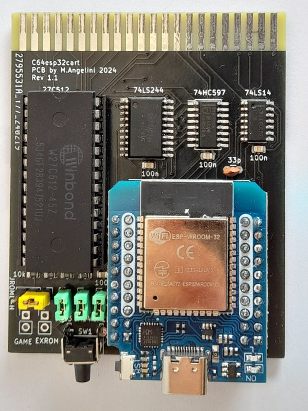<br>
      <sub>Top side, ESP32 fitted</sub>
    </td>
    <td width="33%" align="center">
      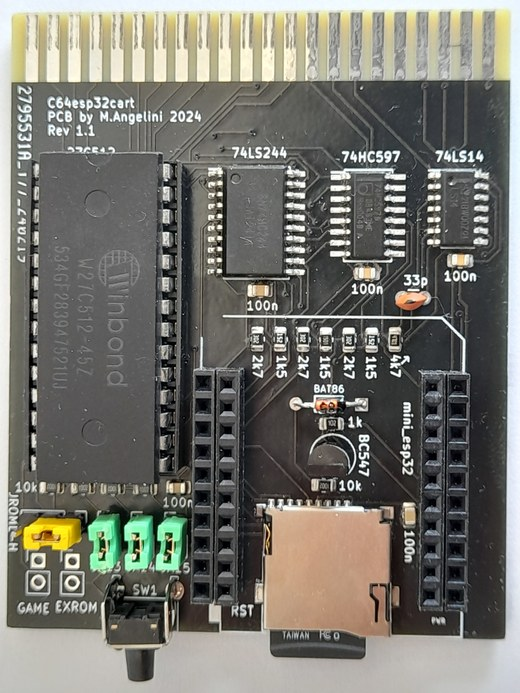<br>
      <sub>Top side, ESP32 removed (microSD slot, BC547, jumpers)</sub>
    </td>
    <td width="33%" align="center">
      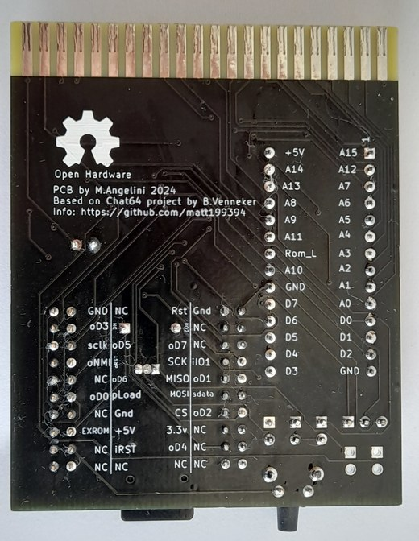<br>
      <sub>Bottom side (solder pads and signal names)</sub>
    </td>
  </tr>
</table>

---

## Table of contents

1. [Features](#features)
2. [Hardware](#hardware)
3. [Schematic](#schematic)
4. [Menu and keys](#menu-and-keys)
5. [Screenshots](#screenshots)
6. [Jumper configuration](#jumper-configuration)
7. [Boot: the EPROM bootstrap](#boot-the-eprom-bootstrap)
8. [ESP32 firmware](#esp32-firmware)
9. [SAM: the C64 talks (TALK / NEWS)](#sam-the-c64-talks-talk--news)
10. [secrets.h: WiFi, OpenWeather, NewsAPI](#secretsh-wifi-openweather-newsapi)
11. [Preparing the SD card](#preparing-the-sd-card)
12. [Koala files](#koala-files)
13. [SID files](#sid-files)
14. [PETSCII art (SEQ / D64)](#petscii-art-seq--d64)
15. [Programming the 27C512](#programming-the-27c512)
16. [C64 build commands](#c64-build-commands)
17. [C64 memory layout](#c64-memory-layout)
18. [Troubleshooting](#troubleshooting)

---

## Features

- **Graphical menu** generated by the ESP32 (command 64): frame, centred
  title, left-aligned entries, colour wash on the selected entry,
  UP/DOWN arrows + RETURN.
- **SD card directory** with a frame: F1/F7 previous/next page, RETURN opens
  files and subdirectories, `Q` quits, `/..` goes one level up.
  22 rows per page, listing capped at **12032 bytes**.
- **PRG files and games** loaded from SD: after loading the C64 switches to
  `$01=$37` and returns to BASIC with the program lines relinked.
- **SID player**: F1/F7 previous/next SID, SPACE back to the menu, info screen
  with the header data (name, author, load, init, play, SID model).
- **Koala**: single picture display and **slideshow** (F1/F7, SPACE exits).
- **NEWS**: scrolling text with several selectable RSS/JSON sources
  (ANSA, Rai News, Repubblica, Il Sole 24 Ore, Google News, NewsAPI,
  BBC World, Al Jazeera, SCMP, CGTN World).
- **NEWS backgrounds**: PETSCII ART, KOALA from the current directory,
  CLOCK / WEATHER (snapshot).
- **PETSCII art**: generated patterns (city, stars, bricks, maze) refreshed
  every ~60 s; ROM charset on top, 2x2 font only on the scroller rows.
- **PETSCII SEQ slideshow**, both standalone (auto-advance, F7 forward,
  F1 back, SPACE exits) and during NEWS.
- **Weather and clock** from OpenWeather + NTP, dedicated screen with
  centred, coloured text.
- **SUPERMON**: RAM monitor at `$A000` (command 50).
- **HELP** page listing every feature (command 63).
- **BASIC ROM disabled** inside the menu, so `$A000-$BFFF` becomes usable RAM.
- **Menu template** stored at `$9800-$9FCF` and reloaded when a SID or a PRG
  overwrites it.
- **SAM TALK** (SAM build): type a line, press RETURN and the ESP32 speaks it
  through the C64; RUN/STOP goes back to the menu. SAM is **commercial
  software** and is not part of this repository — see the notice in
  [SAM: the C64 talks](#sam-the-c64-talks-talk--news).
- **SAM NEWS** (SAM build): pick one of the news sources, the ESP32 downloads
  the headlines, **prints the same text on the C64 screen** and reads it out
  loud; the sentence being spoken is highlighted in yellow (karaoke), any key
  stops the speech and returns to the menu.
- **4-bit audio** on `$D418` (SID volume register): only 16 levels, faint.
- **Optional, non-blocking WiFi**: without a network the menu still works,
  weather/NEWS are simply disabled.
- **8K EPROM bootstrap**: the full menu lives on the SD card
  (`espnewsauto.prg`), so it can be updated without reprogramming the 27C512.

---

## Hardware

| Component | Notes |
|---|---|
| ESP32 | MH ET LIVE ESP32MiniKit / ESP32-WROOM-32; FQBN `esp32:esp32:mhetesp32minikit` |
| EEPROM | 27C512 (64K), only 8K used as a cartridge at `$8000-$9FFF` |
| microSD | on VSPI: `MOSI=23`, `MISO=19`, `SCK=18`, `CS=5` |
| EXROM | driven by **GPIO2** (`CLED`) through a BC547: HIGH = EXROM low = EEPROM mapped |
| C64 reset | `GPIO21` (`oC64RST`) through a buffer |
| Reset button | net `iRST` -> **only** `GPIO15` (not wired to the C64 `/RESET`): the firmware polls it and restarts ESP32 + C64 |
| C64 NMI | `GPIO32` |
| Data bus | 74LS244 (`$DF00` on read) + shift register (`$DE00` on write) |
| I/O1 / I/O2 | `GPIO35` / `GPIO36` (interrupts) |

Video of the cartridge in action:
<https://www.youtube.com/watch?v=Q0KYe2STK2w>

---

## Schematic

Click the picture to open it full size (1800 px wide).

[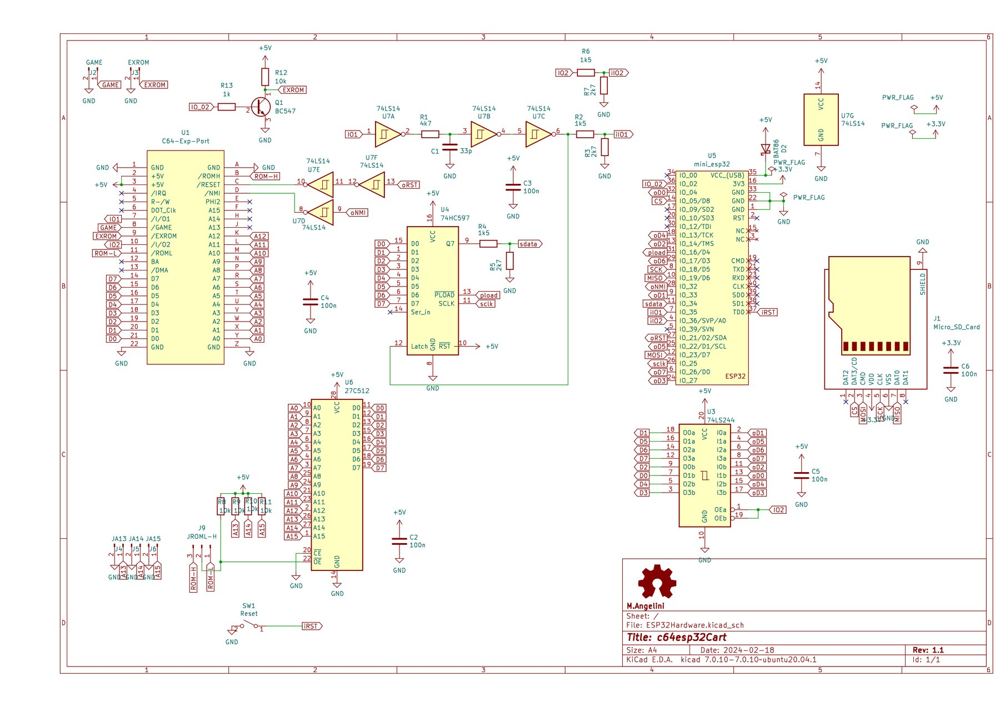](schematic.jpg)

Full KiCad 7 project (schematic + PCB, rev 1.1) is in
[`c64esp32crt1.1_kicad7/`](c64esp32crt1.1_kicad7):

| File | Content |
|---|---|
| `ESP32Hardware.kicad_sch` / `.kicad_pcb` | KiCad sources |
| `schematic.pdf` | printable schematic |
| `gerber/` | fabrication files |

Main blocks: C64 expansion port (`U1`), 74LS244 data buffer (`U3`),
74HC597 shift register (`U4`), 74LS14 Schmitt triggers for `RST`/`NMI`
(`U7`), BC547 EXROM driver (`Q1`, base from `IO_02` via `R13`), and the
`GAME`/`EXROM`/`ROML`/`ROMH` jumpers.

---

## Menu and keys

```
C64 ESP32 CARTRIDGE
BY M.ANGELINI
MAIN MENU
  SD CARD              -> SD directory (PRG, SID, Koala)
  SUPERMON             -> RAM monitor at $A000
  HELP                 -> help page
  CLOCK / WEATHER      -> time and weather (refreshed every ~5 s)
  BASIC                -> back to BASIC
  KOALA                -> show the loaded Koala
  NEWS                 -> pick a source -> pick a background -> scroller
  KOALA SLIDESHOW      -> slideshow of the Koalas in the current directory
  PETSCII SLIDESHOW    -> slideshow of the .seq files in /petscii-seq
```

| Key | Action |
|---|---|
| UP / DOWN | move the selection |
| RETURN | confirm |
| F1 / F7 | previous / next page (directory), previous / next picture (slideshows, SID) |
| SPACE | leave NEWS, slideshows, weather |
| Q | quit the directory |
| Y / N | answer to `PLAY LOADED SID? Y/N` before slideshows and NEWS |

Choosing `2) MENU WITH SAM` in the EPROM boot menu loads a smaller menu
(`espsamauto.prg`) that gives up SUPERMON / CLOCK / KOALA / NEWS / SLIDESHOWS
to make room for the voice:

```
C64 ESP32 CARTRIDGE
BY M.ANGELINI
MAIN MENU
  SD CARD              -> SD directory (PRG, SID, Koala)
  HELP                 -> help page (SAM version)
  BASIC                -> back to BASIC
  SAM TALK             -> type a line, RETURN reads it
  SAM NEWS             -> pick a source, text on screen read by SAM
```

| Key | Action |
|---|---|
| UP / DOWN | move the selection |
| RETURN | confirm / send the typed line to SAM |
| RUN/STOP | stop the speech, back to the menu |
| any key | stop SAM NEWS and go back to the menu |

---

## Screenshots

All pictures below are **real captures of the cartridge running on a C64**
(VLC snapshots of the video output, saved at 840 px wide and shown at 420 px).

<table>
  <tr>
    <td width="50%" align="center">
      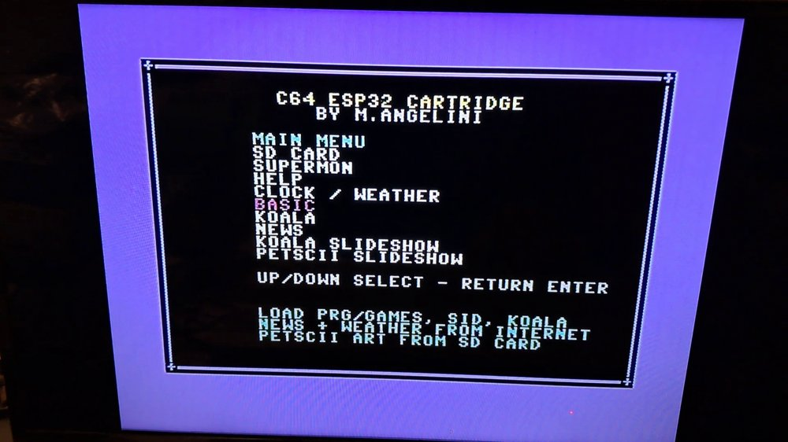<br>
      <b>Main menu</b>
    </td>
    <td width="50%" align="center">
      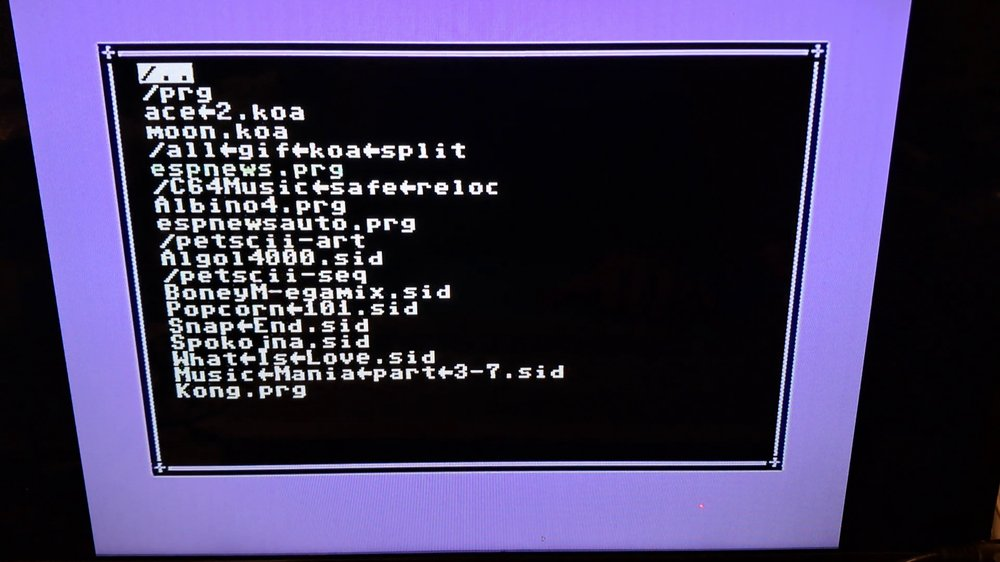<br>
      <b>SD directory</b>
    </td>
  </tr>
  <tr>
    <td width="50%" align="center">
      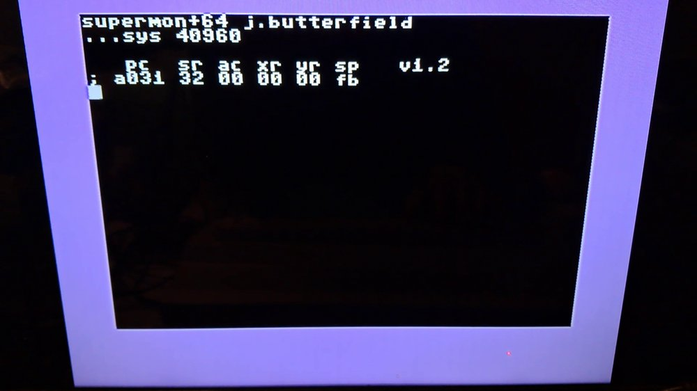<br>
      <b>SUPERMON ($A000)</b>
    </td>
    <td width="50%" align="center">
      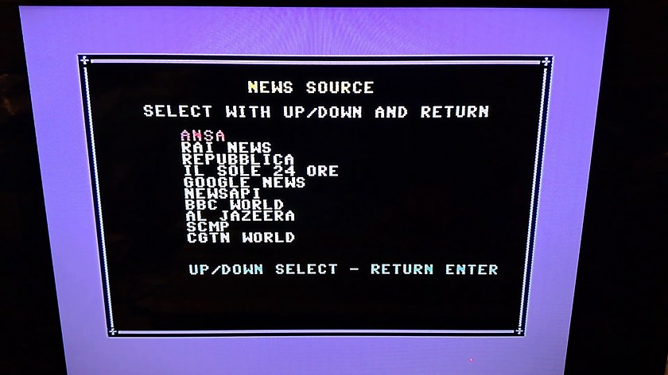<br>
      <b>NEWS source selection</b>
    </td>
  </tr>
  <tr>
    <td width="50%" align="center">
      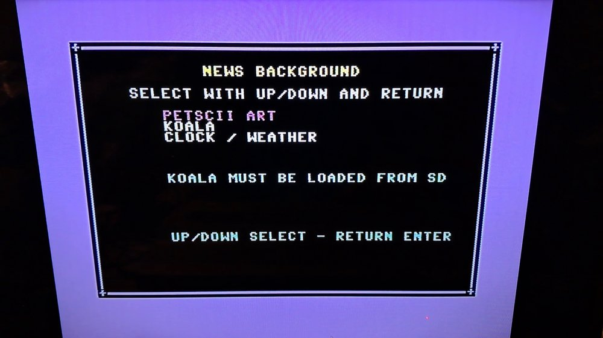<br>
      <b>NEWS background selection</b>
    </td>
    <td width="50%" align="center">
      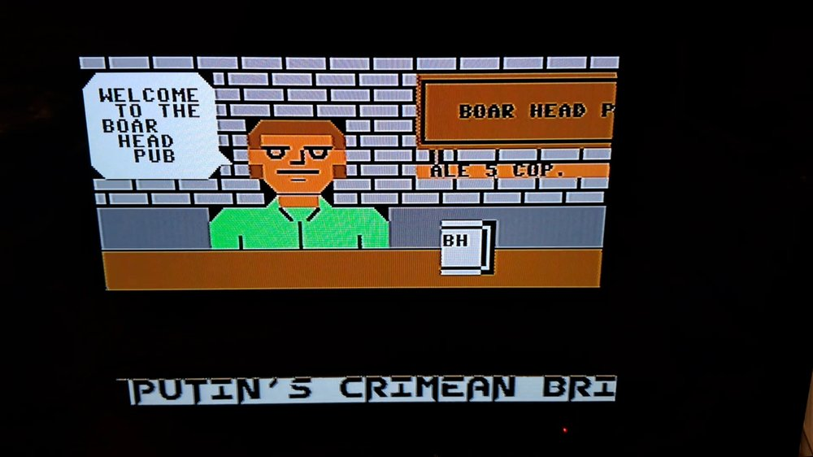<br>
      <b>NEWS with a PETSCII art background</b>
    </td>
  </tr>
  <tr>
    <td width="50%" align="center">
      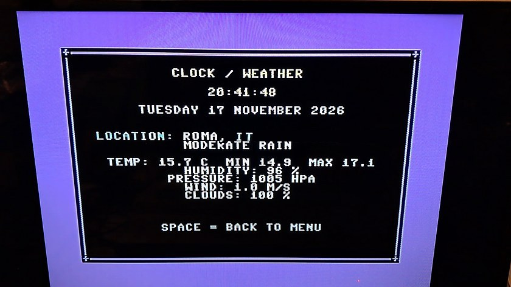<br>
      <b>CLOCK / WEATHER</b>
    </td>
    <td width="50%" align="center">
      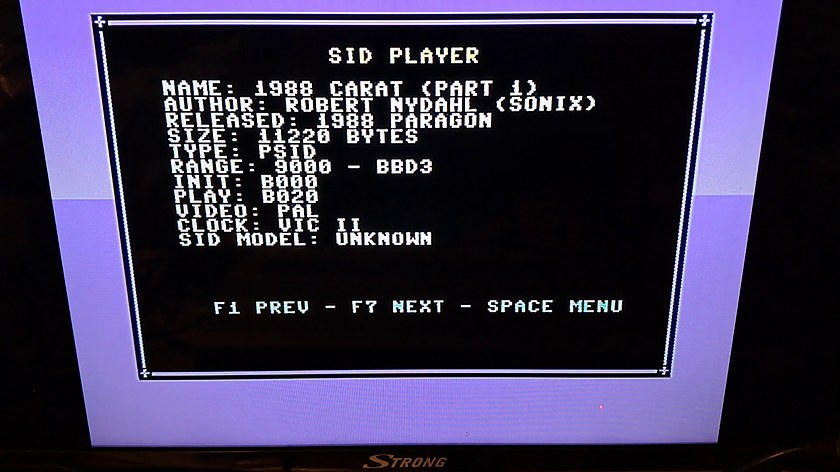<br>
      <b>SID player</b>
    </td>
  </tr>
</table>

> Missing a real photo for a screen? `tools/render_menu.py docs/renders`
> writes fallback renders of the ESP32 templates (same texts, colours and
> layout) into that folder.
>
> In the CLOCK/WEATHER capture the city name was replaced with a neutral one
> ("ROMA") so the author's location is not published.

---

## Jumper configuration

All jumpers are on the `c64esp32crt1.1` board (see `c64esp32crt1.1_kicad7/`).

| Jumper | Function | Correct position |
|---|---|---|
| **J4** (JA13) | EEPROM A13 -> GND | **installed** |
| **J5** (JA14) | EEPROM A14 -> GND | **installed** |
| **J6** (JA15) | EEPROM A15 -> GND | **installed** |
| **J9** | EEPROM `/OE` <- `/ROML` or `/ROMH` | **pins 1-2 = ROM-L** |
| **J2** | GAME -> GND (Ultimax mode) | **open** |
| **J3** | EXROM -> GND (cartridge always mapped) | **open** (test only) |

### Why A13/A14/A15 jumpers matter

A13/A14/A15 have a pull-up to +5V (`R9`/`R10`/`R11`) and a jumper to GND:

| JA13 / JA14 / JA15 | A13 A14 A15 | Bank read | Offset in the 64K file |
|---|---|---|---|
| all absent | 1 1 1 | **7** | `0xE000` |
| all installed | 0 0 0 | **0** | `0x0000` |

Without the three jumpers the C64 reads bank 7: if the bootstrap only lives in
bank 0, it does not find the `CBM80` signature and boots normal BASIC (blue
screen with a light blue border) **without starting the cartridge**.

To be independent of the jumpers, the 64K image is generated by replicating
the 8K in all 8 banks (see [Programming the 27C512](#programming-the-27c512)).

### EXROM: keep J3 open

With **J3** installed the EXROM line is shorted to GND: the cartridge stays
mapped all the time and command `112` (which has to *remove* the EEPROM to free
`$8000-$9FFF` as RAM) has no effect. It is only useful as a "is the ROM being
read at all?" test. In normal use **J3 open**: EXROM is driven only by the
transistor on GPIO2.

---

## Boot: the EPROM bootstrap

The EEPROM only contains a small bootstrap; the full menu is a PRG on the SD
card, so it can be updated without reprogramming the EEPROM.

Real sequence (verified on hardware):

1. on power-up the ESP32 boots and sets `CLED HIGH` -> **EXROM low**;
2. the ESP32 pulses the C64 reset line (`GPIO21`);
3. the C64 finds `CBM80` at `$8000` and jumps to the EEPROM `coldstart`;
4. the bootstrap copies a ~600-byte loader to `$C000` and starts it;
5. the loader shows a **framed boot menu** (`C64 ESP32 CARTRIDGE`, yellow
   title, `BY M.ANGELINI` in light grey, then `1) MENU WITHOUT SAM` /
   `2) MENU WITH SAM`, all text in English like the rest of the program) and
   waits for key `1` or `2`; if 2 is chosen it sends
   command **113** ("SAM build": the ESP32 prepares the menu with the SAM
   entries). The screen is a 40x25 template (1024 screen codes + 1024 colours)
   generated by `tools/make_boot_menu.py` into `boot_menu.inc` and embedded in
   the 8K EEPROM image, so the menu appears instantly, even before the ESP32
   has finished its setup;
6. it sends command **112** to the ESP32 (EXROM high: the EEPROM
   disappears and `$8000-$9FFF` becomes RAM again);
7. it asks for the file name (command **51**: `espnewsauto.prg`, or
   `espsamauto.prg` when 2 was chosen), loads it at `$0801` (command **53**)
   and asks for the entry point (command **60**, parsed from the `SYS` in the
   BASIC line);
8. it jumps to the entry point: the PRG copies the menu to `$C000` and starts.

> **Warning (historic bug):** the bootstrap must **not** call `CLR`
> (`$a659`) or the BASIC relink routine (`$a533`) before jumping to the entry
> point. The cartridge cold start only initialises the KERNAL
> (`IOINIT`/`RAMTAS`/`RESTOR`/`CINT`), so `TXTTAB`/`VARTAB`/`ARYTAB`/`STREND`
> may hold garbage: the result was a silent crash (frozen screen, the menu
> never started).

Debug build of the bootstrap, showing its progress on screen (useful during
bring-up: it shows how far it gets and checksums the received PRG):

```bash
acme -DDBGBOOT=1 -o c64esp8kBOOT_dbg.bin bootstrap.asm
```

| Sign | Meaning |
|---|---|
| white border, black background | EEPROM mapped, `coldstart` running |
| `2`, cyan border | loader copied to `$C000` |
| `3`, green border | ESP32 answered command 112 |
| `4`, yellow border | file name sent |
| `5`, purple border | PRG received |
| `6`, light green border | entry point received |
| hex line | first 16 bytes at `$0801`, end page, entry point, checksum (`5A47` expected) |

---

## ESP32 firmware

```bash
arduino-cli compile --fqbn esp32:esp32:mhetesp32minikit c64esp32Cart
arduino-cli upload  -p /dev/ttyACM0 --fqbn esp32:esp32:mhetesp32minikit c64esp32Cart
```

On boot the firmware:

1. configures the pins, drives **EXROM low** (cartridge mapped) and resets
   the C64;
2. opens the serial port (115200) and, if configured, connects to WiFi
   (**non-blocking**: 15 s timeout, then it moves on);
3. mounts the SD card, scans the current directory and prepares the Koala list;
4. EXROM stays **low** (EEPROM mapped) until the loader sends command `112`,
   with **no timeout**: when the ESP32 is powered from USB and the C64 is
   switched on later, the EEPROM must still be mapped or the cartridge would
   not boot. Only command `112` raises EXROM (log: `EXROM alto (comando 112)`).

Useful serial log (115200): requested file name,
`PRG: load $xxxx, entry $xxxx`, `SID: load $xxxx, N byte`, SD errors.

Two separate test sketches exist and are not used in production:

```bash
arduino-cli compile --fqbn esp32:esp32:mhetesp32minikit comms_test   # bus/NMI test
arduino-cli compile --fqbn esp32:esp32:mhetesp32minikit audio_test   # 4-bit audio test
```

---

> ### ⚠️ SAM is commercial software
>
> SAM (**Software Automatic Mouth**) and its source code are **proprietary
> software**; all rights remain with their respective owners (originally
> *Don't Ask Software* / *SoftVoice*). SAM is **not** included in this
> repository, is **not** redistributed here and is **not** covered by any
> licence granted by this project: it **must not be used for commercial
> purposes** without the express authorisation of the rights holder. Copying
> the sources into a local build (see [`SAM_SOURCES.md`](SAM_SOURCES.md)) is
> the user's own responsibility — this project uses them for personal,
> non-commercial use only. Everything else in this repository is the author's
> own code.

## SAM: the C64 talks (TALK / NEWS)

**SAM** (Software Automatic Mouth) runs on the **ESP32**, not on the C64: the
ESP32 turns text into 4-bit samples at 11025 Hz and streams them to the C64,
which plays them on the SID volume register `$D418` from an NMI handler
(one NMI per sample, handshake on `$DF00`). This is why the voice costs no
CPU on the C64: it sounds while the C64 only prints.

Enable it by choosing `2) MENU WITH SAM` in the EPROM boot menu: the loader
sends command **113** and loads `espsamauto.prg`; the menu then loads
`samplayer.prg` from the **SD root** when a voice entry is chosen (command
119), so both files must be on the card.

ESP32 commands used by the voice: **113** SAM build, **114** stop the speech,
**115** a line to pronounce, **116** pronounce the downloaded news, **117**
news source index, **118** news text to the C64, **119** load
`/samplayer.prg`.

### SAM TALK

Type a line on the C64 (up to 63 characters, echoed on screen), press
RETURN: the line goes to the ESP32 (command 115), which splits it into pieces
of at most 16 characters (~1.6 s), synthesises them and plays them one after
the other. **RUN/STOP** stops the voice and returns to the menu.

Default language is Italian (rules in `it2sam.c`, which maps Italian sounds
onto SAM's English phoneme tables). To force a language, start the line with
`/en ` or `/it ` — the backslash does not exist on the C64 keyboard:

```
/en hello world, this is sam
/it ciao, questa e' la voce italiana
```

### SAM NEWS

1. Choose **SAM NEWS**: the source screen is the same as the normal NEWS
   (command 65), RETURN confirms;
2. the index is sent with command **117** and the ESP32 downloads the
   headlines **once** (kept in RAM until the source changes);
3. command **118** sends the text to the C64 at `$A000` plus a table of
   "pieces" at `$A500` (offset in the shown text + sample count);
4. the player **prints the text on screen** (`SAM NEWS` in reverse video on
   row 1, `press a key to stop` on row 2, text from row 3, up to ~800
   characters, cut at the last space so no word is split) and then speaks it;
5. while the voice goes on, the C64 counts the samples in the NMI handler and
   **highlights in yellow the piece being spoken** (karaoke), restoring the
   previous one to light blue;
6. any key stops the speech and returns to the menu (the ESP32 gets command
   114 before the NMI vector is changed back).

The text on screen is exactly what SAM reads, after this preprocessing in the
firmware:

- source name in **UPPERCASE** + `: ` before the headlines;
- first letter of each sentence capitalised;
- **numbers turned into words** (`9` -> "nove", `2028` -> "duemila
  ventotto"), because SAM's phonemes ignore digits;
- accented vowels written as letter + apostrophe (`a'`, `e'`, ...);
- Italian sources (ANSA, Rai News, Repubblica, Il Sole 24 Ore, Google News,
  NewsAPI) -> Italian phonemes; foreign ones (BBC, Al Jazeera, SCMP, CGTN) ->
  English Reciter;
- cursor off while the text is printed, so nothing blinks in the middle.

Notes: the SID volume register is **4 bit** (16 levels), so the voice is
audible but faint; SAM needs a contiguous `malloc` of ~44 KB
(`SAM_BUF_SECONDS 2`), which is released after every sentence so the news
download of the normal menu keeps working.

### Sources and build switch (they are NOT in this repository)

SAM is **commercial software** (SoftVoice / Don't Ask Software): its C sources
are not part of this public repository and are listed in `.gitignore`.

- how to add them (file list, where they come from, the two required patches)
  and how to build without them: see [`SAM_SOURCES.md`](SAM_SOURCES.md);
- `tools/check_sam_sources.sh` checks presence of the files and the patches;
- the compile-time switch is `ENABLE_SAM` (auto-detected, or forced with
  `--build-property "build.extra_flags=-DENABLE_SAM=0"`). Without SAM the
  firmware still builds (85% flash instead of 88%) and everything works except
  the voice; SAM commands answer with an empty block and log
  `SAM: questa build non include SAM`.

---

## secrets.h: WiFi, OpenWeather, NewsAPI

The firmware includes `secrets.h`, which is **not versioned**:

```bash
cp c64esp32Cart/secrets.example.h c64esp32Cart/secrets.h
```

```c
#pragma once

const char *ssid = "YOUR_WIFI_SSID";
const char *password = "YOUR_WIFI_PASSWORD";
String openweatherApiKey = "YOUR_OPENWEATHER_API_KEY";
String openweatherLat = "xxxxx";   // latitudine in gradi decimali
String openweatherLon = "xxxxx";   // longitudine in gradi decimali
String newsApiKey = "YOUR_NEWSAPI_KEY";
```

### OpenWeather

Free key from <https://openweathermap.org/api> (*Current Weather* plan).

The request is:

```
http://api.openweathermap.org/data/2.5/weather?lat=<LAT>&lon=<LON>&units=metric&appid=<KEY>
```

- `units=metric` -> temperature in °C, wind in m/s, pressure in hPa;
- **latitude and longitude go in `secrets.h`** (`openweatherLat` /
  `openweatherLon`, decimal degrees, e.g. Rome `41.9028` / `12.4964`) so the
  position never ends up in the repository;
- if they are left as `xxxxx` the firmware only logs
  `Meteo: lat/lon non configurate in secrets.h` and the weather screen shows
  `WIFI NOT CONNECTED` / no data — WiFi, SD and the rest keep working.

From the JSON response the firmware uses `weather[0].description`, `name`,
`sys.country`, `main.temp/temp_min/temp_max/humidity/pressure`, `wind.speed`
and `clouds.all`.

### Clock (NTP)

`NTPClient` on `pool.ntp.org`, fixed offset in `getTime()`:

```c
timeClient.setTimeOffset(3600);   // GMT+1 (winter time), 7200 for DST
```

### NewsAPI

Only needed for the **NewsAPI** source (`NEWSAPI_KEY` in `secrets.h`); every
other source is a public RSS feed and needs no key.

---

## Preparing the SD card

**FAT32** formatted, any label (the reference card is 7.4 GB, label
`8074-0EDB`). Files can use long names as long as the extension is recognised.

Typical layout:

```
/                              <- root: espnewsauto.prg and the folders
├── espnewsauto.prg            <- full menu (bootstrap choice 1)
├── espsamauto.prg             <- menu + SAM talk (bootstrap choice 2)
├── samplayer.prg              <- player SAM a $0801 (solo choice 2)
├── C64Music_safe_reloc/       <- SIDs relocated to $4000 (see below)
├── all_gif_koa_split/         <- .kla/.koa pictures
├── petscii-art/               <- .d64 files with PETSCII art (SEQ)
└── petscii-seq/               <- .seq files + manifest.txt / seqlist.txt
```

Practical notes:

- **`espnewsauto.prg` must be in the root**: the bootstrap asks the ESP32 for
  exactly that name (or `espsamauto.prg` if 2 is chosen in the boot menu).
- The **directory listing** is capped at **12032 bytes** (roughly 300 entries):
  beyond that the list is truncated, so that it cannot overwrite the SIDs at
  `$4000` or the code at `$C000`. Use subdirectories for large collections.
- Names longer than **37 characters** are shortened in the display.
- The firmware uses service files that **never show up** in the listing:
  `directory.txt` (leftover from older versions, deleted at boot),
  `koalist.txt` (Koala list cache) and `petscii-seq/seqlist.txt`
  (`manifest.txt` takes precedence when present).
- `koalist.txt` is only a cache in the current directory: delete it freely, it
  is recreated on the next scan.
- Updating the menu only means replacing `espnewsauto.prg`: no EEPROM
  reprogramming needed.

Build the menu PRG (self-starting, the one that goes on the SD card):

```bash
acme -DCART=1 -DPRGAUTO=1 c64esp32cart.asm
# -> espnewsauto.prg   (BASIC: LOAD"espnewsauto.prg",8 + RUN)
```

---

## Koala files

Standard Koala format: **10001 bytes**, i.e.

| Block | Bytes | C64 destination |
|---|---:|---|
| bitmap | 8000 | `$6000-$7F3F` |
| video matrix | 1000 | `$7F40-$8327` |
| colour RAM | 1000 | `$8328-$8710` |
| background colour | 1 | `$8710` |

- Accepted extensions: **`.kla`** and **`.koa`** (case-insensitive);
  `moon.kla` in the repository is an example.
- A 10002-10009 byte file is treated as having a leading header (typically the
  2-byte load address `$00 $60`) and that header is **skipped**: the
  destination is always `$6000`.
- A shorter or corrupted file gives wrong pictures or a black screen: it must
  be exactly 10001 bytes (plus the optional header).
- Pictures are also used as the **NEWS background** and by the **slideshow**
  (which lists only the Koalas of the current directory).
- No conversion needed: `.kla`/`.koa` files are used as they are.

---

## SID files

- **PSID** format (v1/v2; v3 with data offset `$7e` is handled).
- The player uses the header `init`/`play` addresses; when `play = 0` the tune
  is self-contained (its own IRQ).
- The extension must be **`.sid`**.

### Relocation: `$4000` or `$9000`

The cartridge uses almost all of the C64 RAM, so SIDs **cannot stay where they
were compiled**: they must be relocated. The safe choice is `$4000-$5FFF`,
which is why the directory listing is kept below `$4000`.

| Area | Use | Conflict mask |
|---|---|---|
| `$0400-$07E7` | screen | `01` |
| `$0800-$0FFF` | charset | `02` |
| `$2000-$3F3F` | Koala bitmap | `04` |
| `$4000-$5FFF` | **SIDs (ideal)** | none |
| `$6000-$8710` | Koala source | `08` |
| `$8800-$BFFF` | NEWS text, PETSCII art, SEQ staging (RAM, BASIC ROM off) | `10` |
| `$9800-$9FCF` | menu template | `40` |
| `$C000-$CFFF` | menu code | `20` |

- SIDs at **`$4000-$5FFF`**: compatible with everything.
- SIDs at **`$9000`** (up to `$BFFF`): fine for the SID player and the Koala
  slideshow, but **not** for the SEQ/NEWS slideshow (it would overwrite the
  staging area).
- The firmware computes the actual SID range and compares it against the mask
  of the current feature; on a conflict the background SID does not start.

Relocating with [`sidreloc`](https://github.com/lemontree/sidreloc):

```bash
sidreloc -p 40 -z 80-f0 -q tune.sid tune_4000.sid   # target $4000
sidreloc -p 90 -z 80-f0 -q tune.sid tune_9000.sid   # target $9000
```

The scripts in this repository automate this over an HVSC collection:

```bash
# 1) scan SID memory ranges (find the ones that fit below $6000)
tools/scan_sids_ranges.py /path/to/C64Music /tmp/sid_scan.tsv

# 2) relocate the candidates and drop the ones that end up out of range
SIDRELOC=~/c64/sidreloc-1.0/sidreloc \
tools/relocate_safe_sids.py /path/to/C64Music /tmp/sid_scan.tsv /tmp/C64Music_safe_reloc
```

Then copy the resulting folder to the SD card (e.g. `C64Music_safe_reloc/`).

---

## PETSCII art (SEQ / D64)

### During NEWS: `/petscii-art`

The firmware looks for **`.d64`** files in `/petscii-art` (and in the root),
extracts the SEQ pictures and sends them as PETSCII patterns
(commands 89/87/88). Helper scripts:

```bash
tools/extract_seq.py            # extract SEQ files from .d64 and write manifest.txt
tools/televideo_fetch.sh        # RAI Televideo (PNG) -> .koa
```

### Standalone slideshow: `/petscii-seq`

- **`.seq`** files (one per picture);
- optional `/petscii-seq/manifest.txt`, one entry per line:
  `name.seq`, `name.seq<TAB>size<TAB>origin<TAB>CBM name`, or
  `/petscii-seq/name.seq`;
- without a manifest the firmware falls back to
  `/petscii-seq/seqlist.txt`, created as a cache on first boot.

Without a manifest the first scan of the folder is slow; with `manifest.txt`
(created by `tools/extract_seq.py`) the slideshow starts immediately.

---

## Programming the 27C512

You need a TL866II+ (or compatible) programmer and `minipro`.

### 1. Build the bootstrap and the 64K image

```bash
acme bootstrap.asm                                  # -> c64esp8kBOOT.bin (8192 bytes)
tools/make_eprom_image.sh all c64esp8kBOOT.bin      # -> W27C512_c64esp8kBOOT.bin (64K)
```

`all` replicates the 8K into **all 8 banks** (recommended: independent of the
jumpers). To fill a single bank use `tools/make_eprom_image.sh 0 ...`
(bank 0 -> offset `0x0000`, bank 7 -> `0xE000`, everything else `0xFF`).

### 2. Write and verify

```bash
minipro -p 'W27C512@DIP28' -z                            # pin test / blank check
minipro -p 'W27C512@DIP28' -w W27C512_c64esp8kBOOT.bin   # write + verify
minipro -p 'W27C512@DIP28' -r /tmp/W27C512_verify.bin    # read-back
cmp /tmp/W27C512_verify.bin W27C512_c64esp8kBOOT.bin
```

If the pin test reports `Bad contact on pin:...` (usually pin 1 or pins
25-28) the EEPROM is not seated properly in the ZIF socket: open the lever,
straighten the pins, push it fully in and retry. With good contacts the
read-back must match byte for byte.

### 3. Dumping an existing EEPROM

```bash
minipro -p 'W27C512@DIP28' -r ~/work/c64esp32cart/W27C512_dump.bin
```

`W27C512_*.bin`, `c64esp8kBOOT.bin` and `c64esp8kBOOT_dbg.bin` are local build
artifacts and are not versioned.

---

## C64 build commands

| Target | Command | Output |
|---|---|---|
| 8K ROM (whole menu in the EEPROM) | `acme -DCART=1 c64esp32cart.asm` | `c64esp8kROM.bin` |
| PRG at `$C000` (manual start) | `acme -DCART=1 -DC400=1 c64esp32cart.asm` | `c64esp32menu_c000_cart.prg` |
| Self-starting PRG from `$0801` | `acme -DCART=1 -DPRGAUTO=1 c64esp32cart.asm` | `espnewsauto.prg` |
| SAM menu (boot choice 2) | `acme -DCART=1 -DPRGAUTO=1 -DSAM=1 c64esp32cart.asm` | `espsamauto.prg` |
| SAM player a `$0801` | `acme samplayer.asm` | `samplayer.prg` |
| Simulated PRG (no cartridge) | `acme c64esp32cart.asm` | `c64esp32menu.prg` |
| 8K EPROM bootstrap | `acme bootstrap.asm` | `c64esp8kBOOT.bin` |
| Debug bootstrap | `acme -DDBGBOOT=1 -o c64esp8kBOOT_dbg.bin bootstrap.asm` | `c64esp8kBOOT_dbg.bin` |

Loading manually without the bootstrap (SD2IEC):

```basic
LOAD"c64esp32menu_c000_cart.prg",8,1
SYS 49152
```

or

```basic
LOAD"espnewsauto.prg",8
RUN
```

---

## C64 memory layout

Used by NEWS + Koala + menu (BASIC ROM disabled with `$01=$36`):

| Area | Use |
|---|---|
| `$0400-$07E7` | screen |
| `$0800-$0FFF` | charset |
| `$1000-$3EFF` | directory listing (max 12032 bytes) |
| `$2000-$3F3F` | Koala bitmap |
| `$4000-$5FFF` | relocated SIDs (ideal area) |
| `$6000-$8710` | Koala source |
| `$8800-$8FD0` | NEWS text |
| `$9000-$97CF` | NEWS PETSCII art |
| `$9800-$9FCF` | menu template (screen + colours) |
| `$A000-$BFFF` | SEQ / HELP staging (RAM with BASIC ROM disabled) |
| `$C000-$CFFB` | menu code |

The SAM player (`samplayer.prg`, loaded at `$0801` by the menu) uses:

| Area | Use |
|---|---|
| `$A000-...` | news text sent by the ESP32 (command 118) |
| `$A500-...` | karaoke table: for each piece, offset in the text + samples |
| `$0478` / `$D878` | first character / colour of the text (row 3, column 0) |

---

## Troubleshooting

| Symptom | Cause / fix |
|---|---|
| Blue screen with a light blue border, nothing starts | EEPROM not being read: wrong bank (JA13/14/15 jumpers), `J9` on ROM-H instead of ROM-L, or `J3` installed keeping EXROM low. Also check for `CBM80` at `$8000` |
| Bootstrap starts but stops with no message | build with `-DDBGBOOT=1` to see how far it gets; make sure `espnewsauto.prg` is in the root |
| `23456` on screen and no menu (debug build) | bootstrap calling `CLR`/BASIC relink: see [Boot](#boot-the-eprom-bootstrap) |
| Menu works but weather/NEWS are empty | WiFi not connected or keys missing in `secrets.h`; check the serial log at 115200 |
| SID does not start in slideshow/NEWS | SID not relocated to `$4000` (conflict mask) |
| Directory listing truncated | 12032 byte limit: use subdirectories |
| `Bad contact on pin:...` from minipro | EEPROM not seated properly in the ZIF socket |
| ESP32 does not answer | check `GPIO2`/transistor, NMI on `GPIO32`, I/O1/I/O2 on `GPIO35`/`36` |

---

## Credits

- Hardware based on the *chat64 cart* by Bart Venneker and
  Theo van den Beld.
- Early ESP32 firmware and C64 code written by M. Angelini, now heavily
  rewritten by DeepSeek Flash.
- `sidreloc`: <https://github.com/lemontree/sidreloc>.
- NEWS sources: public RSS feeds of the respective publishers;
  weather: OpenWeather.

All the other code in this repository (ESP32 firmware, C64 assembly, tools,
schematics) is the author's own work, published for personal/hobby use.

**Third-party, not included:** SAM (Software Automatic Mouth — sam.c, sam.h,
render.*, reciter.*, \*Tabs.h, debug.\*) is **commercial software** belonging to
its rights holders: it is **not** part of this repository, is **not**
redistributed with it and **cannot be used for commercial purposes** without
the authorisation of the owner. See [`SAM_SOURCES.md`](SAM_SOURCES.md).

Private files. Never commit `c64esp32Cart/secrets.h` or `firmware_backup/`
(they contain WiFi credentials, API keys and calibration data).
