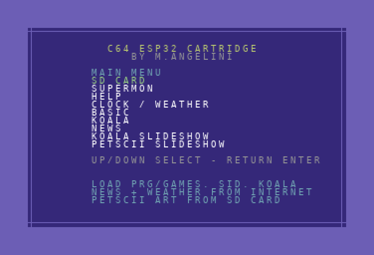
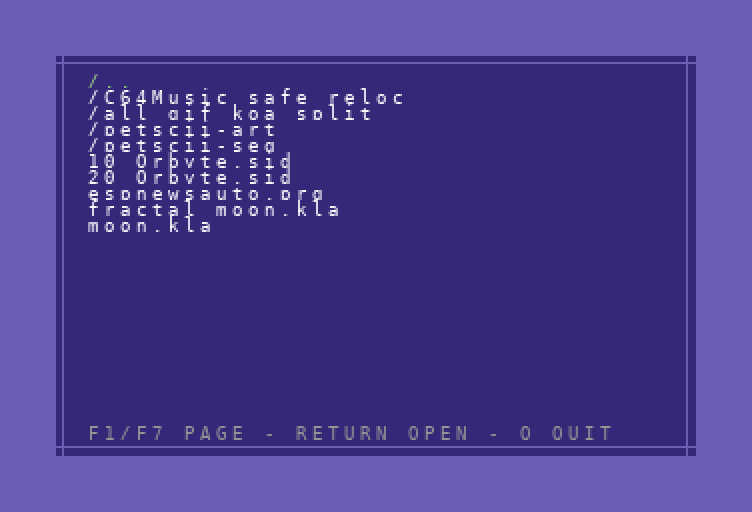
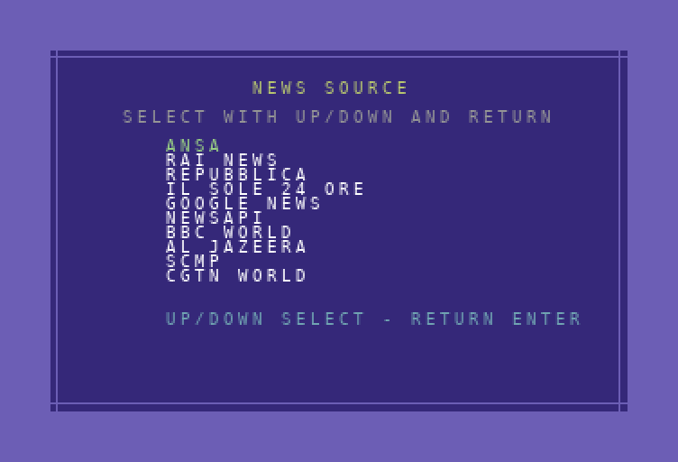
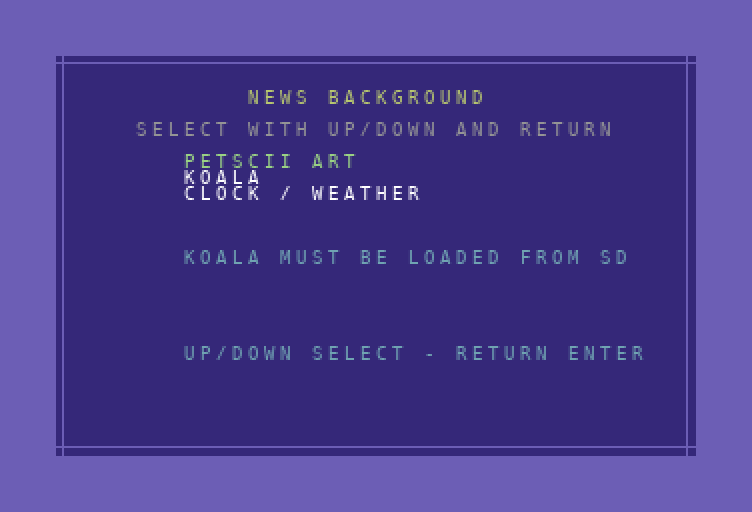
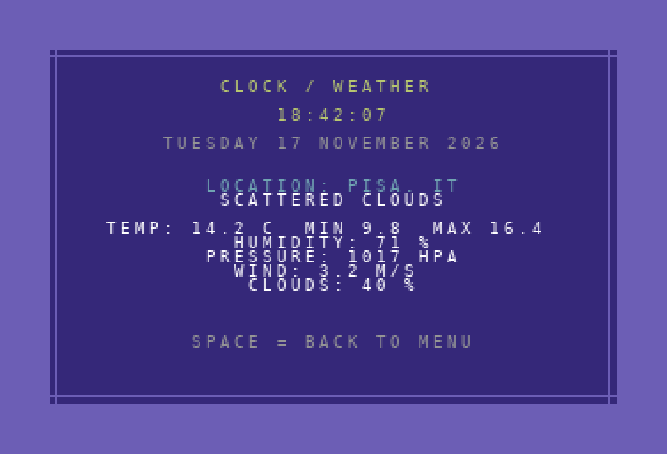
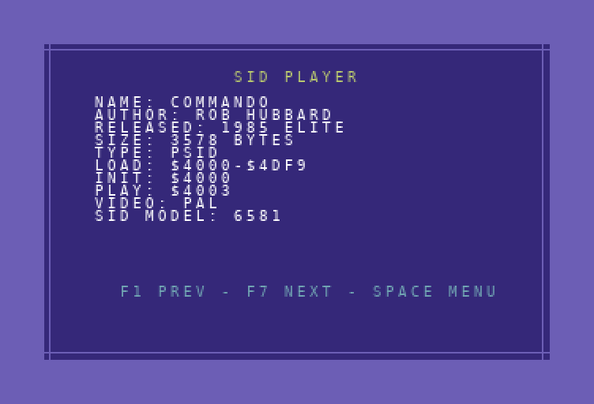
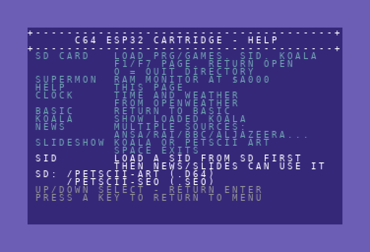

# C64 ESP32 Cart

Cartuccia per Commodore 64 con **ESP32** + **27C512**: il C64 carica PRG, SID,
immagini Koala, NEWS e arte PETSCII dalla microSD dell'ESP32, con menu grafico
generato dall'ESP32 stesso.

Ispirata alla *chat64 cart* di Bart Venneker e Theo van den Beld
(<https://github.com/bvenneker/Chat64>), con diverse modifiche:

- microSD collegata all'ESP32 (SPI);
- EEPROM **27C512** (64K) con jumper per scegliere il banco da 8K;
- transistor per il controllo della linea **EXROM** da parte dell'ESP32;
- jumper per modo standard / Ultimax;
- firmware ESP32 che genera le schermate del menu, legge la SD, scarica
  NEWS e meteo e trasferisce i file al C64 su bus parallelo + NMI.


---

## Indice

1. [Funzioni](#funzioni)
2. [Hardware](#hardware)
3. [Menu e tasti](#menu-e-tasti)
4. [Screenshot](#screenshot)
5. [Configurazione jumper](#configurazione-jumper)
6. [Avvio: bootstrap da EPROM](#avvio-bootstrap-da-eprom)
7. [Firmware ESP32](#firmware-esp32)
8. [secrets.h: WiFi, OpenWeather, NewsAPI](#secretsh-wifi-openweather-newsapi)
9. [Preparare la SD](#preparare-la-sd)
10. [File Koala](#file-koala)
11. [File SID](#file-sid)
12. [Arte PETSCII (SEQ / D64)](#arte-petscii-seq--d64)
13. [Programmare la 27C512](#programmare-la-27c512)
14. [Comandi di build C64](#comandi-di-build-c64)
15. [Layout memoria C64](#layout-memoria-c64)
16. [Troubleshooting](#troubleshooting)

---

## Funzioni

- **Menu grafico** generato dall'ESP32 (comando 64): cornice, titolo centrato,
  voci a sinistra, color wash sulla voce selezionata, frecce SU/GIU + RETURN.
- **Directory SD** con cornice: F1/F7 pagina precedente/successiva,
  RETURN apre file o sottocartelle, `Q` esce, voce `/..` per risalire.
  22 righe per pagina, lista limitata a **12032 byte**.
- **PRG e giochi** caricati dalla SD: dopo il caricamento il C64 passa a
  `$01=$37` e rientra in BASIC con le righe rilinkate.
- **SID player**: F1/F7 SID precedente/successivo, SPACE torna al menu,
  schermata con i dati dell'header (nome, autore, load, init, play, modello).
- **Koala**: visualizzazione singola e **slideshow** (F1/F7, SPACE esce).
- **NEWS**: testo scorrevole con più fonti RSS/JSON selezionabili
  (ANSA, Rai News, Repubblica, Il Sole 24 Ore, Google News, NewsAPI,
  BBC World, Al Jazeera, SCMP, CGTN World).
- **Sfondi NEWS** selezionabili: PETSCII ART, KOALA della directory corrente,
  CLOCK / WEATHER (snapshot).
- **Arte PETSCII**: pattern generati (city, stelle, mattoni, labirinto)
  rigenerati ogni ~60 s; charset ROM in alto e font 2x2 solo nelle righe
  dello scroller.
- **Slideshow PETSCII SEQ** standalone (auto-avanzamento, F7 avanti,
  F1 indietro, SPACE esce) e durante le NEWS.
- **Meteo e ora** da OpenWeather + NTP, schermata dedicata con testi centrati.
- **SUPERMON**: monitor in RAM a `$A000` (comando 50).
- **HELP** in inglese con tutte le funzioni (comando 63).
- **BASIC ROM disattivata** nel menu: `$A000-$BFFF` diventa RAM utilizzabile.
- **Template del menu** salvato a `$9800-$9FCF` e ricaricato se un SID o un PRG
  lo sovrascrive.
- **Audio 4 bit** su `$D418` (volume SID): solo 16 livelli, audio flebile.
- **WiFi opzionale e non bloccante**: se manca la rete il menu funziona lo
  stesso (meteo/NEWS disabilitati).
- **Bootstrap da EPROM 8K**: il menu completo sta sulla SD
  (`espnewsauto.prg`), quindi si aggiorna senza riprogrammare la 27C512.

---

## Hardware

| Componente | Note |
|---|---|
| ESP32 | MH ET LIVE ESP32MiniKit / ESP32-WROOM-32; FQBN `esp32:esp32:mhetesp32minikit` |
| EEPROM | 27C512 (64K), solo 8K usati come cartuccia a `$8000-$9FFF` |
| microSD | su VSPI: `MOSI=23`, `MISO=19`, `SCK=18`, `CS=5` |
| EXROM | controllato da **GPIO2** (`CLED`) via transistor BC547: HIGH = EXROM basso = EPROM mappata |
| Reset C64 | `GPIO21` (`oC64RST`) via buffer |
| NMI C64 | `GPIO32` |
| Bus dati | 74LS244 (`$DF00` in lettura) + shift register (`$DE00` in scrittura) |
| I/O1 / I/O2 | `GPIO35` / `GPIO36` (interrupt) |

Video della cartuccia in funzione:
<https://www.youtube.com/watch?v=Q0KYe2STK2w>

---

## Menu e tasti

```
C64 ESP32 CARTRIDGE
BY M.ANGELINI
MAIN MENU
  SD CARD              -> directory SD (PRG, SID, Koala)
  SUPERMON             -> monitor RAM a $A000
  HELP                 -> pagina di aiuto
  CLOCK / WEATHER      -> ora e meteo (aggiornati ogni ~5 s)
  BASIC                -> ritorno al BASIC
  KOALA                -> mostra il Koala caricato
  NEWS                 -> scelta fonte -> scelta sfondo -> scroller
  KOALA SLIDESHOW      -> slideshow dei Koala della directory corrente
  PETSCII SLIDESHOW    -> slideshow dei .seq in /petscii-seq
```

| Tasto | Funzione |
|---|---|
| SU / GIU | sposta la selezione |
| RETURN | conferma |
| F1 / F7 | pagina precedente / successiva (directory), immagine precedente / successiva (slideshow, SID) |
| SPACE | esce da NEWS, slideshow, meteo |
| Q | esce dalla directory |
| Y / N | risposta a `PLAY LOADED SID? Y/N` prima di slideshow e NEWS |

---

## Screenshot

> Le immagini seguenti sono **render dei template generati dall'ESP32**
> (stessi testi, colori e layout; il font è quello di sistema rasterizzato a
> 8x8, non il charset del C64). Si rigenerano con
> `tools/render_menu.py docs/screenshots`.
> Se hai gli screenshot reali, mettili in `docs/screenshots/` con gli stessi
> nomi: la documentazione li usa automaticamente.

### Menu principale



### Directory SD



### Scelta della fonte NEWS



### Scelta dello sfondo NEWS



### CLOCK / WEATHER



### SID player



### HELP



---

## Configurazione jumper

Tutti i ponticelli sono sulla scheda `c64esp32crt1.1` (vedi
`c64esp32crt1.1_kicad7/`).

| Jumper | Funzione | Posizione corretta |
|---|---|---|
| **J4** (JA13) | A13 della EPROM -> GND | **inserito** |
| **J5** (JA14) | A14 della EPROM -> GND | **inserito** |
| **J6** (JA15) | A15 della EPROM -> GND | **inserito** |
| **J9** | `/OE` EPROM <- `/ROML` o `/ROMH` | **pin 1-2 = ROM-L** |
| **J2** | GAME -> GND (modo Ultimax) | **aperto** |
| **J3** | EXROM -> GND (cart sempre mappata) | **aperto** (solo per test) |

### Perché i jumper A13/A14/A15 contano

A13/A14/A15 hanno un pull-up a +5V (`R9`/`R10`/`R11`) e un jumper verso GND:

| JA13 / JA14 / JA15 | A13 A14 A15 | Banco letto | Offset nel file 64K |
|---|---|---|---|
| tutti assenti | 1 1 1 | **7** | `0xE000` |
| tutti inseriti | 0 0 0 | **0** | `0x0000` |

Senza i tre ponticelli la C64 legge il banco 7: se il bootstrap è solo nel
banco 0 non trova la firma `CBM80` e va al BASIC normale (schermo blu con
bordo celeste), **senza avviare la cartuccia**.

Per non dipendere dai jumper, l'immagine 64K si genera replicando gli 8K in
tutti e 8 i banchi (vedi [Programmare la 27C512](#programmare-la-27c512)).

### EXROM: J3 va lasciato aperto

Con **J3** inserito la linea EXROM è cortocircuitata a GND: la cartuccia resta
sempre mappata e il comando `112` (che deve *rimuovere* la EPROM per lasciare
RAM a `$8000-$9FFF`) non ha effetto. Serve solo come test "la ROM viene letta?".
In uso normale **J3 aperto**: EXROM è comandato solo dal transistor su GPIO2.

---

## Avvio: bootstrap da EPROM

La EPROM contiene solo un piccolo bootstrap; il menu completo è un PRG sulla
SD, quindi aggiornabile senza riprogrammare la EEPROM.

Sequenza reale (verificata su hardware):

1. all'accensione l'ESP32 parte e mette `CLED HIGH` -> **EXROM basso**;
2. l'ESP32 dà un impulso di reset alla C64 (`GPIO21`);
3. la C64 trova `CBM80` a `$8000` e salta al `coldstart` della EPROM;
4. il bootstrap copia un loader di ~340 byte a `$C000` e lo avvia;
5. il loader invia il comando **112** all'ESP32 (EXROM alto: la EPROM sparisce,
   `$8000-$9FFF` torna RAM);
6. chiede il nome file (comando **51**: `espnewsauto.prg`), lo carica a `$0801`
   (comando **53**) e chiede l'entry point (comando **60**, ricavato dal `SYS`
   della riga BASIC);
7. salta all'entry point: il PRG copia il menu a `$C000` e parte.

> **Attenzione (bug storico):** il bootstrap **non** deve chiamare `CLR`
> (`$a659`) né il relink BASIC (`$a533`) prima del salto. Il coldstart da
> cartuccia inizializza solo il KERNAL (`IOINIT`/`RAMTAS`/`RESTOR`/`CINT`),
> quindi `TXTTAB`/`VARTAB`/`ARYTAB`/`STREND` possono contenere spazzatura: il
> risultato era un crash silenzioso (schermo fermo, menu mai avviato).

Build di debug del bootstrap, con avanzamento a schermo (utile per il
bring-up: mostra dove si ferma e fa il checksum del PRG ricevuto):

```bash
acme -DDBGBOOT=1 -o c64esp8kBOOT_dbg.bin bootstrap.asm
```

| Segnale | Significato |
|---|---|
| bordo bianco, sfondo nero | EPROM mappata, coldstart eseguito |
| `2`, bordo ciano | loader copiato a `$C000` |
| `3`, bordo verde | ESP32 ha risposto al comando 112 |
| `4`, bordo giallo | nome file inviato |
| `5`, bordo viola | PRG ricevuto |
| `6`, bordo verde chiaro | entry point ricevuto |
| riga hex | primi 16 byte a `$0801`, fine pagina, entry, checksum (`5A47` atteso) |

---

## Firmware ESP32

```bash
arduino-cli compile --fqbn esp32:esp32:mhetesp32minikit c64esp32Cart
arduino-cli upload  -p /dev/ttyACM0 --fqbn esp32:esp32:mhetesp32minikit c64esp32Cart
```

All'avvio il firmware:

1. configura i pin, mette **EXROM basso** (cart mappata) e resetta la C64;
2. apre la seriale (115200) e, se configurato, si collega al WiFi
   (**non bloccante**: 15 s di timeout, poi prosegue);
3. monta la SD, scansiona la directory corrente e prepara la lista Koala;
4. dopo 1.5 s alza EXROM come fallback (il loader lo alza comunque con `112`).

Log seriale utile per il debug (115200): nome file richiesto,
`PRG: load $xxxx, entry $xxxx`, `SID: load $xxxx, N byte`, errori SD.

Ci sono anche due sketch di test separati, non usati in produzione:

```bash
arduino-cli compile --fqbn esp32:esp32:mhetesp32minikit comms_test   # test bus/NMI
arduino-cli compile --fqbn esp32:esp32:mhetesp32minikit audio_test   # test audio 4 bit
```

---

## secrets.h: WiFi, OpenWeather, NewsAPI

Il firmware include `secrets.h`, che **non è versionato**:

```bash
cp c64esp32Cart/secrets.example.h c64esp32Cart/secrets.h
```

```c
#pragma once

const char *ssid = "YOUR_WIFI_SSID";
const char *password = "YOUR_WIFI_PASSWORD";
String openweatherApiKey = "YOUR_OPENWEATHER_API_KEY";
String newsApiKey = "YOUR_NEWSAPI_KEY";
```

### OpenWeather

Chiave gratuita su <https://openweathermap.org/api> (piano *Current Weather*).

La richiesta è:

```
http://api.openweathermap.org/data/2.5/weather?lat=<LAT>&lon=<LON>&units=metric&appid=<KEY>
```

- `units=metric` -> temperatura in °C, vento in m/s, pressione in hPa;
- **latitudine e longitudine sono nel firmware**, non in `secrets.h`:
  `String lat = ...; String lon = ...;` in `c64esp32Cart/c64esp32Cart.ino`.

Dalla risposta vengono usati `weather[0].description`, `name`, `sys.country`,
`main.temp/temp_min/temp_max/humidity/pressure`, `wind.speed`, `clouds.all`.

### Ora (NTP)

`NTPClient` su `pool.ntp.org`, offset fisso in `getTime()`:

```c
timeClient.setTimeOffset(3600);   // GMT+1 (ora solare), 7200 per l'ora legale
```

### NewsAPI

Serve solo per la fonte **NewsAPI** (`NEWSAPI_KEY` in `secrets.h`); tutte le
altre fonti sono RSS pubbliche e non richiedono chiave.

---

## Preparare la SD

Formato **FAT32**, etichetta libera (nella versione di riferimento 7.4 GB,
label `8074-0EDB`). Il firmware legge solo file a 8.3 o nomi lunghi purché
con estensione riconosciuta.

Struttura tipica:

```
/                              <- root: espnewsauto.prg e le cartelle
├── espnewsauto.prg            <- menu completo (caricato dal bootstrap)
├── C64Music_safe_reloc/       <- SID rilocati a $4000 (vedi sotto)
├── all_gif_koa_split/         <- immagini .kla/.koa
├── petscii-art/               <- .d64 con arte PETSCII (SEQ)
└── petscii-seq/               <- .seq + manifest.txt / seqlist.txt
```

Note pratiche:

- **`espnewsauto.prg` deve stare nella root**: il bootstrap chiede proprio
  quel nome (16 caratteri) all'ESP32.
- La **lista directory** è limitata a **12032 byte** (circa 300 voci):
  oltre, la lista viene troncata per non sovrascrivere i SID a `$4000` e il
  codice a `$C000`. Mettere molti file in sottocartelle.
- I nomi più lunghi di **37 caratteri** vengono accorciati nella visualizzazione.
- Sulla SD il firmware usa file di servizio che **non** compaiono nella lista
  della directory: `directory.txt` (residuo delle versioni precedenti, viene
  cancellato all'avvio), `koalist.txt` (cache della lista Koala) e
  `petscii-seq/seqlist.txt` (`manifest.txt` se presente ha la precedenza).
- `koalist.txt` è solo una cache nella directory corrente: si può cancellare,
  viene ricreata alla prima scansione.
- Per aggiornare il menu basta sostituire `espnewsauto.prg`: nessuna
  riprogrammazione della EPROM.

Build del PRG del menu (auto-avviante, quello che va sulla SD):

```bash
acme -DCART=1 -DPRGAUTO=1 c64esp32cart.asm
# -> espnewsauto.prg   (BASIC: LOAD"espnewsauto.prg",8 + RUN)
```

---

## File Koala

Formato Koala standard: **10001 byte**, cioè

| Blocco | Byte | Destinazione C64 |
|---|---:|---|
| bitmap | 8000 | `$6000-$7F3F` |
| video matrix | 1000 | `$7F40-$8327` |
| color RAM | 1000 | `$8328-$8710` |
| colore di sfondo | 1 | `$8710` |

- Estensioni riconosciute: **`.kla`** e **`.koa`** (case-insensitive);
  `moon.kla` nel repository è un esempio.
- Se il file è 10002-10009 byte viene considerato un header iniziale
  (tipicamente 2 byte di load address `$00 $60`) e **saltato**: la
  destinazione è comunque `$6000`.
- Un file più corto o corrotto dà immagini sbagliate o schermo nero: deve
  essere esattamente 10001 byte (+ eventuale header).
- L'immagine viene usata anche come **sfondo delle NEWS** e nello
  **slideshow** (che elenca solo i Koala della directory corrente).
- Non serve convertire nulla: i Koala `.kla`/`.koa` si caricano così come sono.

---

## File SID

- Formato **PSID** (v1/v2; v3 con data offset `$7e` è gestito).
- Il player usa `init`/`play` dell'header; se `play = 0` il brano è
  autosufficiente (IRQ proprio).
- L'estensione deve essere **`.sid`**.

### Rilocazione: `$4000` o `$9000`

La cartuccia usa quasi tutta la RAM del C64, quindi i SID **non possono stare
dove sono stati compilati**: vanno rilocati. Il caso sicuro è `$4000-$5FFF`,
perché la lista directory viene tenuta sotto `$4000` proprio per non toccarli.

| Zona | Uso | Maschera conflitto |
|---|---|---|
| `$0400-$07E7` | screen | `01` |
| `$0800-$0FFF` | charset | `02` |
| `$2000-$3F3F` | bitmap Koala | `04` |
| `$4000-$5FFF` | **SID (ideale)** | nessuna |
| `$6000-$8710` | sorgente Koala | `08` |
| `$8800-$BFFF` | testo NEWS, arte PETSCII, staging SEQ (RAM con BASIC ROM spenta) | `10` |
| `$9800-$9FCF` | template menu | `40` |
| `$C000-$CFFF` | codice del menu | `20` |

- SID a **`$4000-$5FFF`**: compatibili con tutto.
- SID a **`$9000`** (fino a `$BFFF`): ok per il SID player e lo slideshow
  Koala, ma **non** per lo slideshow SEQ/NEWS (sovrascriverebbe lo staging).
- Il firmware calcola il range effettivo del SID e lo confronta con la maschera
  della funzione; se c'è conflitto il SID di sottofondo non parte.

Rilocazione con [`sidreloc`](https://github.com/lemontree/sidreloc):

```bash
sidreloc -p 40 -z 80-f0 -q brano.sid brano_4000.sid   # target $4000
sidreloc -p 90 -z 80-f0 -q brano.sid brano_9000.sid   # target $9000
```

Gli script del repository automatizzano la cosa su una collezione HVSC:

```bash
# 1) scansiona le lunghezze dei SID (trova quelli che stanno sotto $6000)
tools/scan_sids_ranges.py /percorso/C64Music /tmp/sid_scan.tsv

# 2) riloca i candidati e scarta quelli che finiscono fuori range
SIDRELOC=~/c64/sidreloc-1.0/sidreloc \
tools/relocate_safe_sids.py /percorso/C64Music /tmp/sid_scan.tsv /tmp/C64Music_safe_reloc
```

Copiare poi la cartella risultante sulla SD (es. `C64Music_safe_reloc/`).

---

## Arte PETSCII (SEQ / D64)

### Durante le NEWS: `/petscii-art`

Il firmware cerca file **`.d64`** in `/petscii-art` (e nella root), ne estrae
le immagini SEQ e le invia come pattern PETSCII (comando 89/87/88).
Gli script di supporto:

```bash
tools/extract_seq.py            # estrae i SEQ dai .d64 e crea manifest.txt
tools/televideo_fetch.sh        # Televideo RAI (PNG) -> .koa
```

### Slideshow standalone: `/petscii-seq`

- file **`.seq`** (uno per immagine);
- opzionale `/petscii-seq/manifest.txt` (uno per riga:
  `nome.seq`, `nome.seq<TAB>dimensione<TAB>origine<TAB>nome CBM`, oppure
  `/petscii-seq/nome.seq`);
- in assenza di manifest vale `/petscii-seq/seqlist.txt`, generato dal
  firmware come cache al primo avvio.

Senza manifest la prima scansione della cartella è lenta; con
`manifest.txt` (creato da `tools/extract_seq.py`) lo slideshow parte subito.

---

## Programmare la 27C512

Serve un programmatore TL866II+ (o compatibile) e `minipro`.

### 1. Build del bootstrap e dell'immagine 64K

```bash
acme bootstrap.asm                                  # -> c64esp8kBOOT.bin (8192 byte)
tools/make_eprom_image.sh all c64esp8kBOOT.bin      # -> W27C512_c64esp8kBOOT.bin (64K)
```

`all` replica gli 8K in **tutti e 8 i banchi** (consigliato: indipendente dai
jumper). Per scrivere solo un banco: `tools/make_eprom_image.sh 0 ...`
(banco 0 -> offset `0x0000`, banco 7 -> `0xE000`, il resto `0xFF`).

### 2. Scrittura e verifica

```bash
minipro -p 'W27C512@DIP28' -z                            # pin test / blank check
minipro -p 'W27C512@DIP28' -w W27C512_c64esp8kBOOT.bin   # write + verify
minipro -p 'W27C512@DIP28' -r /tmp/W27C512_verify.bin    # read-back
cmp /tmp/W27C512_verify.bin W27C512_c64esp8kBOOT.bin
```

Se il pin test segnala `Bad contact on pin:...` (tipicamente 1 o 25-28) la
EPROM è inserita male nel ZIF: aprire la leva, raddrizzare i piedini,
reinserire a fondo e ripetere. Con i contatti a posto il read-back deve
combaciare byte per byte.

### 3. Dump di una EPROM esistente

```bash
minipro -p 'W27C512@DIP28' -r ~/lavoro/c64esp32cart/W27C512_dump.bin
```

I file `W27C512_*.bin`, `c64esp8kBOOT.bin` e `c64esp8kBOOT_dbg.bin` sono
artefatti locali e non vengono versionati.

---

## Comandi di build C64

| Obiettivo | Comando | Output |
|---|---|---|
| ROM 8K (menu tutto in EPROM) | `acme -DCART=1 c64esp32cart.asm` | `c64esp8kROM.bin` |
| PRG a `$C000` (manuale) | `acme -DCART=1 -DC400=1 c64esp32cart.asm` | `c64esp32menu_c000_cart.prg` |
| PRG auto-avviante da `$0801` | `acme -DCART=1 -DPRGAUTO=1 c64esp32cart.asm` | `espnewsauto.prg` |
| PRG simulato (senza cartuccia) | `acme c64esp32cart.asm` | `c64esp32menu.prg` |
| Bootstrap EPROM 8K | `acme bootstrap.asm` | `c64esp8kBOOT.bin` |
| Bootstrap debug | `acme -DDBGBOOT=1 -o c64esp8kBOOT_dbg.bin bootstrap.asm` | `c64esp8kBOOT_dbg.bin` |

Caricamento manuale senza bootstrap (SD2IEC):

```basic
LOAD"c64esp32menu_c000_cart.prg",8,1
SYS 49152
```

oppure

```basic
LOAD"espnewsauto.prg",8
RUN
```

---

## Layout memoria C64

Usato da NEWS + Koala + menu (BASIC ROM spenta con `$01=$36`):

| Area | Uso |
|---|---|
| `$0400-$07E7` | screen |
| `$0800-$0FFF` | charset |
| `$1000-$3EFF` | lista directory (max 12032 byte) |
| `$2000-$3F3F` | bitmap Koala |
| `$4000-$5FFF` | SID rilocati (area ideale) |
| `$6000-$8710` | sorgente Koala |
| `$8800-$8FD0` | testo NEWS |
| `$9000-$97CF` | arte PETSCII NEWS |
| `$9800-$9FCF` | template menu (screen + colori) |
| `$A000-$BFFF` | staging SEQ / HELP (RAM con BASIC ROM spenta) |
| `$C000-$CFFB` | codice del menu |

---

## Troubleshooting

| Sintomo | Causa / rimedio |
|---|---|
| Schermo blu con bordo celeste, nessun avvio | EPROM non letta: banco sbagliato (jumper JA13/14/15), `J9` su ROM-H invece di ROM-L, oppure `J3` inserito che tiene EXROM basso. Verificare anche `CBM80` a `$8000` |
| Bootstrap parte ma si ferma senza messaggi | build `-DDBGBOOT=1` per vedere dove; controllare che `espnewsauto.prg` sia nella root |
| `23456` a schermo e niente menu (build debug) | bootstrap che chiama `CLR`/relink BASIC: vedi [Avvio](#avvio-bootstrap-da-eprom) |
| Menu ok ma meteo/NEWS vuoti | WiFi non connesso o chiavi in `secrets.h`; log seriale a 115200 |
| SID non parte in slideshow/NEWS | SID non rilocato a `$4000` (maschera di conflitto) |
| Directory troncata | limite 12032 byte: usare sottocartelle |
| `Bad contact on pin:...` con minipro | EPROM non inserita bene nel ZIF |
| ESP32 non risponde | verificare `GPIO2`/transistor, NMI su `GPIO32`, I/O1/I/O2 su `GPIO35`/`36` |

---

## Crediti

- Idea e hardware originali: *chat64 cart* di Bart Venneker e Theo van den Beld.
- Firmware ESP32 e codice C64: Matteo Angelini.
- `sidreloc`: <https://github.com/lemontree/sidreloc>.
- Fonti NEWS: RSS pubbliche dei rispettivi editori; meteo: OpenWeather.

Repository privato. Non committare mai `c64esp32Cart/secrets.h`
né `firmware_backup/` (contengono WiFi, chiavi API e calibrazione).
